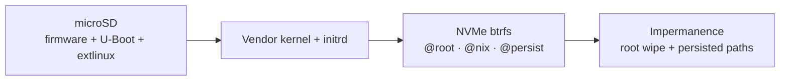

# NixOS on Raspberry Pi 5 with an NVMe root

Reusable NixOS modules for a Raspberry Pi 5 with an ephemeral btrfs root on
NVMe, plus a throwaway SD-card installer for `nixos-anywhere` (no kexec).

I reinstall the same Pi 5 hosts often enough that re-deriving the boot chain
each time is a tax, so the knowledge lives here once. Import a stack, set a
hostname, done. There is no default boot medium: `sd-boot` is the stock layout
that needs no patches, `nvme-boot` keeps firmware, U-Boot, and `/boot` on the
NVMe and carries a patched U-Boot until the fixes land upstream.

The build, flash, and install steps are plain `nix build`, `dd`, and
`nixos-anywhere` invocations; the quick start lists them verbatim.

## The tree

| Path | What it is |
|------|------------|
| `modules/require-boot-medium.nix` | The assertion that the stack you imported picked a boot medium. |
| `modules/boot/sd.nix` | disko description of the SD card's existing firmware and `/boot` partitions. |
| `modules/boot/nvme.nix` | The three-partition NVMe-only layout and the patched U-Boot. |
| `modules/storage.nix` | btrfs subvolumes, mount options, fstrim, auto-scrub. |
| `modules/impermanence.nix` | What persists, the per-boot root reset, optional snapper. |
| `modules/installer.nix` | Turns a configuration into the throwaway bootstrap SD image. |
| `modules/raspberry-pi-5.nix` | The two fixes the `nixos-hardware` Pi 5 profile still needs. |
| `modules/lib/labels.nix` | Partition labels and SD geometry shared by the image and the hosts. |
| `modules/root-wipe.sh` | The initrd script that resets `@root`. |
| `pkgs/uboot-nvme/` | Patched U-Boot 2026.10 and the provenance of every patch. |
| `eeprom/` | The non-declarative Pi 5 bootloader configuration. |
| `flake.nix` | The public surface: modules, `mkPi5Installer`, the patched U-Boot package. |

## Flake outputs

There are two full stacks, named after the boot medium they choose. Import
exactly one.

| Import | Means |
|--------|-------|
| `nixosModules.sd-boot` | Everything, with the bootloader on the microSD card. Stock, unpatched. |
| `nixosModules.nvme-boot` | Everything, with firmware + U-Boot + `/boot` on the NVMe. No SD card at runtime. |
| `nixosModules.base` | Everything except a boot medium. Only for composing yourself. |
| `nixosModules.boot-sd` / `boot-nvme` | The granular boot modules. `boot-nvme` needs `hardware` and `storage`. |
| `nixosModules.hardware` | Pi 5 vendor kernel, firmware staging, U-Boot, initrd module closure fix. |
| `nixosModules.storage` | The NVMe btrfs layout. |
| `nixosModules.impermanence` | Per-boot root reset, persisted paths, optional snapper. |
| `nixosModules.installer` | The installer image role. Use `lib.mkPi5Installer` instead. |
| `lib.mkPi5Installer` | Builds an installer `nixosConfiguration` from a few arguments. |
| `packages.aarch64-linux.uboot-nvme` | The patched U-Boot 2026.10. |

The module wrappers close over this flake's `nixos-hardware`, `disko`, and
`impermanence` inputs, so consumers do not pass `inputs` through `specialArgs`
or import those modules themselves. The NVMe-only path also closes over a
pinned `nixpkgs-uboot` input, because the main nixpkgs pin ships U-Boot
2026.07, which cannot boot from NVMe. Do not bump the main `nixpkgs` pin to get
a newer U-Boot: newer `nixos-unstable` removed `boot.initrd.systemd.enable`,
which `pi5.impermanence` still uses.

This flake exports no host or installer configurations: they live in the
consuming flake, where the SSH keys are real. Build an installer with
`lib.mkPi5Installer` and point `images.<name>` at its `sdImage`.

## Architecture

Two boot chains, selected explicitly in the host configuration:

```
SD boot:
  Pi 5 EEPROM -> firmware (SD p1 FAT) -> u-boot.bin -> extlinux.conf (SD p2 ext4)
              -> vendor kernel + initrd -> NVMe root (btrfs)

NVMe-only boot:
  Pi 5 EEPROM -> firmware + u-boot.bin (NVMe p1 FAT)
              -> extlinux.conf (NVMe p2 ext4) -> vendor kernel + initrd
              -> NVMe root (NVMe p3 btrfs)
```




- **The boot path is explicit.** `base` has no boot medium; the two boot
  modules are mutually exclusive because they both claim `/boot` and
  `/boot/firmware`. Importing both is an evaluation error.
- **SD boot: microSD owns the bootloader.** The card has the stock
  two-partition `sd-image-aarch64` layout. `/boot` is rewritten by the host
  configuration on every rebuild.
- **NVMe-only boot: NVMe owns firmware, U-Boot, and `/boot`.** The SD card is
  only the installer medium. Remove it after installation; the EEPROM keeps the
  SD fallback so a reflashed installer still boots for recovery.
- **NVMe owns the system and persistent state.** `@root` is reset on every
  boot; `@persist` is the only state that survives. `@nix` and `@snapshots` are
  separate subvolumes.
- **Vendor kernel, not mainline.** The `nixos-hardware` profile defaults to
  `linux-rpi`. Mainline plus the vendor firmware DTBs produced
  `rp1_driver -22` (EINVAL) probe failures on real hardware, which killed both
  USB and Ethernet. This applies to both boot paths.
- **No kexec.** The bootstrap image sets `system.nixos.variant_id =
  "installer"`, which makes `nixos-anywhere` skip kexec. Pi 5 kexec is flaky;
  SD-image boot is the supported path.
- **No U-Boot fork, but a temporary patch set for NVMe-only boot.** The SD path
  uses stock nixpkgs + `nixos-hardware` firmware staging. The NVMe path needs
  U-Boot 2026.10 with Torsten Duwe's DMA-ranges parent-walk fix and NVMe
  config, plus a `boot_targets` follow-up. Those patches are carried in
  `pkgs/uboot-nvme/` and are expected to be dropped once U-Boot ships them.

### Design decisions

| Decision | Value | Why |
|----------|-------|-----|
| nixpkgs | `nixos-unstable`, pinned | At extraction time the stable 26.05 SD images lacked the Pi 5 boot files; pinning means updates happen deliberately. |
| U-Boot nixpkgs | separate `nixpkgs-uboot` pin | The main pin ships U-Boot 2026.07, which lacks the NVMe inbound-address-translation fix. Floating the main pin would break `boot.initrd.systemd.enable`. |
| Board support | `nixos-hardware.nixosModules.raspberry-pi-5` | Upstream profile: extlinux, BCM2712 DTB filter, NVMe/PCIe/RP1 initrd modules, firmware staging. |
| Kernel | vendor `linux-rpi` | Mainline plus the vendor firmware DTBs broke RP1 (USB + Ethernet) with `-22`/EINVAL probe failures. |
| Boot device (SD path) | microSD owns the bootloader | Stock U-Boot 2026.10 + extlinux, no board-specific boot code, no EEPROM dependency. |
| Boot device (NVMe path) | NVMe owns firmware + U-Boot + `/boot` | U-Boot 2026.10 with the NVMe patch set boots with no SD card; the SD stays a recovery fallback in the EEPROM order. |
| Filesystem | btrfs for the root | Checksums and scrubs without a third-party module constraining kernel updates; ZFS is heavier for 4/8 GB boards. |
| `/boot` filesystem | ext4 (btrfs unsupported here) | U-Boot's extlinux path reads ext4; the NVMe-only layout keeps `/boot` off the btrfs root. |
| Install | `nixos-anywhere`, kexec skipped | Pi 5 kexec is flaky; `variant_id = "installer"` makes nixos-anywhere use the SD-image boot path. |

The SD layout is deliberately the stock two-partition shape. A persistent rescue
partition was tried and dropped: every real incident still ended in a reflash,
while the extra partition added partition math and boot-order ambiguity.

### SD card layout

Created by flashing the bootstrap image. It is the installer medium for both
boot paths, and the permanent boot medium for the SD-boot path. Normal rebuilds
leave the partitions in place and rewrite `/boot`; a hard reset may touch them,
so treat the SD card as disposable.

| Partition | FS | Mount | Contents |
|-----------|----|-------|----------|
| p1 | FAT32, label `FIRMWARE` | `/boot/firmware` | GPU boot code, DTBs, overlays, `config.txt`, `u-boot.bin` |
| p2 | ext4, label `NIXOS_BOOT`, bootable | `/boot` | `extlinux.conf`, kernel, initrd per generation |

For the NVMe-only path, the SD card is only needed to boot the installer; remove
it after `nixos-anywhere` finishes. Keep the reflashed installer as a recovery
medium: the EEPROM boot order falls back to SD.

Use an 8 GB or larger microSD card. The installer's ext4 root is resized to
4 GiB so the target closure fits during `nixos-anywhere`; the built image is
about 4.3 GiB raw (1.4 GiB compressed).

### NVMe layout

The disk that carries the system. A hard reset destroys and recreates it. The
partition layout depends on the boot path.

#### SD-boot layout

One btrfs partition (`NVME_ROOT`) holding the subvolumes below. The partition is
a plain Linux filesystem; the GPT legacy-BIOS-bootable attribute is not set
because U-Boot boots from the SD card.

#### NVMe-only layout

| Partition | Size | FS | Label | Mount |
|-----------|------|----|-------|-------|
| p1 | 256 MiB | FAT32 | `FIRMWARE` | `/boot/firmware` |
| p2 | 2 GiB | ext4, legacy-BIOS-bootable | `NVME_BOOT` | `/boot` |
| p3 | rest | btrfs | `NVME_ROOT` | `/` + subvolumes |

`pi5.nvmeBoot.firmwareSize` and `pi5.nvmeBoot.bootSize` control the first two
sizes. The `/boot` partition is marked legacy-BIOS-bootable (GPT attribute bit
2), which U-Boot's extlinux bootflow expects. Keep `/boot` on ext4 or FAT, not
on the btrfs root.

`NVME_BOOT` is deliberately not `NIXOS_BOOT`: that label already names the
installer SD card's ext4 partition, and an inserted installer SD would make
`/dev/disk/by-label` lookups ambiguous during recovery.

Both layouts use the same subvolumes on the btrfs partition:

| Subvolume | Mount | Lifetime |
|-----------|-------|----------|
| `@root` | `/` | Reset to an empty subvolume at every boot |
| `@nix` | `/nix` | Persists (the Nix store) |
| `@persist` | `/persist` | Persists: `machine-id`, SSH host keys, `/var/lib/nixos`, `/var/log`, plus whatever you add |
| `@snapshots` | `/snapshots` | snapper's snapshot store for `/persist` |

Mount options are `noatime,compress=zstd,nodiscard`; `services.fstrim` batches
discards instead of paying write amplification on every freed block.

## Quick start

### 1. Add this flake as an input

```nix
{
  inputs = {
    nixpkgs.url = "github:NixOS/nixpkgs/nixos-unstable";

    pi5 = {
      url = "path:../nixos-raspberry-pi-5"; # or github:esselius/nixos-raspberry-pi-5
      # Use your own nixpkgs/disko/impermanence pins, or omit this to use the
      # versions this flake was tested with.
      inputs.nixpkgs.follows = "nixpkgs";
    };
  };

  outputs = { self, nixpkgs, pi5, ... }:
  let
    # The boot medium is the choice, so it is the name.
    mkHost = bootModule: modules: nixpkgs.lib.nixosSystem {
      system = "aarch64-linux";
      modules = [ pi5.nixosModules.${bootModule} ] ++ modules;
    };
  in {
    nixosConfigurations = {
      rpi5-8gb = mkHost "sd-boot" [ ./hosts/rpi5-8gb.nix ];
      rpi5-8gb-nvme = mkHost "nvme-boot" [ ./hosts/rpi5-8gb-nvme.nix ];

      rpi5-bootstrap = pi5.lib.mkPi5Installer {
        hostName = "rpi5-bootstrap";
        sshAuthorizedKeys = [ "ssh-ed25519 AAAA... you@workstation" ];
        extraModules = [ { system.stateVersion = "26.05"; } ];
      };
    };

    images.rpi5-bootstrap =
      self.nixosConfigurations.rpi5-bootstrap.config.system.build.sdImage;
  };
}
```

A host module is the hostname, a state version, and your own access policy:

```nix
# hosts/rpi5-8gb.nix — the whole minimum. Everything Pi 5, NVMe, and boot
# related comes from the module.
{
  networking.hostName = "rpi5-8gb";
  system.stateVersion = "26.05";
}
```

For a non-HAT+ M.2 adapter, add the PCIe setting and the EEPROM config from
`eeprom/`:

```nix
hardware.raspberry-pi.configtxt.settings.pi5.dtparam = [ "pciex1" ];
```

`mkPi5Installer` wires the installer module, Raspberry Pi 5 hardware support,
and `system.stateVersion`. `extraModules` is where project-wide settings (SSH,
Nix settings, state version overrides) belong.

### 2. Build and flash the installer

```bash
# The installer image is an aarch64-linux derivation.
nix build .#images.rpi5-bootstrap
# → result/sd-image/*.img.zst

# Find the card with `diskutil list` (macOS) or `lsblk` (Linux).
# On macOS write to the raw disk, /dev/rdiskN: it is much faster than /dev/diskN.
zstd -dc result/sd-image/*.img.zst | sudo dd of=/dev/rdisk4 bs=4m
sync
```

Use an 8 GB or larger card. The image is about 4.3 GiB raw.

### 3. Boot the Pi and install over the network

Insert the SD card, attach the NVMe, connect Ethernet, and power on. The
installer gets an address over DHCP. From the workstation:

```bash
# Hard reset: disko destroys and recreates the NVMe.
# `--disko-mode disko` is nixos-anywhere's default; it is written out because
# the soft reset below changes it.
nixos-anywhere --flake .#rpi5-8gb --build-on auto --disko-mode disko \
  --target-host root@192.168.50.80
```

`--build-on auto` builds locally when the workstation can, and falls back to
building on the Pi. `--build-on remote` forces the Pi to build; useful from a
machine that cannot build aarch64-linux.

### 4. Soft reset (reuse the NVMe)

If the SD card or its bootloader is broken but the NVMe is fine, reflash the
installer and run:

```bash
nixos-anywhere --flake .#rpi5-8gb --build-on auto --disko-mode mount \
  --target-host root@192.168.50.80
```

`--disko-mode mount` mounts the existing NVMe filesystems and the SD card and
then rewrites the system and bootloader without destroying the NVMe.

If the NVMe previously held a ZFS pool, disko may skip `mkfs.btrfs` because the
installer has ZFS disabled and cannot destroy the pool. Discard the disk from
the booted installer first, then run the hard reset:

```bash
ssh root@192.168.50.80 'sudo blkdiscard -f /dev/nvme0n1'
```

### 5. NVMe-only path (no SD card at runtime)

For a host using `nixosModules.nvme-boot`, the flow is the same until the
install, plus a one-time EEPROM change so the firmware tries NVMe first:

```bash
# BOOT_ORDER=0xf416 (NVMe -> SD -> USB -> restart) and PCIE_PROBE=1.
scp eeprom/boot.conf root@<installer-ip>:/tmp/boot.conf
ssh root@<installer-ip> 'sudo rpi-eeprom-config --apply /tmp/boot.conf'

# The SD card is only the installer medium now.
nixos-anywhere --flake .#rpi5-8gb-nvme --build-on auto --disko-mode disko \
  --target-host root@<installer-ip>
```

If the target lacks `rpi-eeprom-config`, run the apply through
`nix shell nixpkgs#raspberrypi-eeprom`. EEPROM changes take effect on the next
power cycle.

Power off, remove the SD card, and power on. The firmware should report
`Boot mode: NVME (06)`, then U-Boot boots `nvme#0...part_2` with extlinux. Keep
the reflashed installer; with the SD inserted, U-Boot's standard boot order
still scans MMC before NVMe, so the installer boots for recovery. See
`eeprom/README.md` for the bootloader details and the HAT+ caveat.

Because the NVMe-only stack declares only the NVMe's three partitions, disko and
`nixos-anywhere` put firmware, U-Boot, extlinux, the kernel, and the btrfs root
all on the NVMe; the installer SD is not part of the mount set.

## Module reference

`base` is `hardware` + `storage` + `impermanence`, and deliberately has no boot
medium. `sd-boot` and `nvme-boot` are `base` plus one boot module. If you import
`storage`, `boot-sd`, `boot-nvme`, or `impermanence` individually, also import
`hardware` for actual hardware support, and make sure the storage modules agree
on subvolume names and mount points. `boot-nvme` also needs `storage`, because
it replaces that module's NVMe partition layout. `impermanence` expects a
mounted persist filesystem, and derives its root device, root subvolume, persist
path, and snapshot mount from `storage` unless you set them yourself.

`boot-sd` and `boot-nvme` are mutually exclusive: both claim `/boot` and
`/boot/firmware`.

### `pi5.nvme`

| Option | Default | Notes |
|--------|---------|-------|
| `device` | `"/dev/nvme0n1"` | Whole disk; `/dev/disk/by-id/...` is recommended with multiple NVMe devices. |
| `partitionLabel` | `"NVME_ROOT"` | Used by the initrd root reset, not the kernel device name. |
| `mountOptions` | `[ "noatime" "compress=zstd" "nodiscard" ]` | Applied to every subvolume. |
| `subvolumes` | `@root→/`, `@nix→/nix`, `@persist→/persist`, `@snapshots→/snapshots` | Subvolume name to mount point. |

The module also enables `services.fstrim` and scrubs the `@persist` mount.

### `pi5.sdBoot`

| Option | Default | Notes |
|--------|---------|-------|
| `device` | `"/dev/mmcblk0"` | Pi 5 SD slot. |
| `firmwareLabel` | `"FIRMWARE"` | Must match the installer's FAT volume label. |
| `rootLabel` | `"NIXOS_BOOT"` | Must match `pi5.installer.rootVolumeLabel`. |

The mounts are fixed at `/boot/firmware` (vfat) and `/boot` (ext4), matching
`generic-extlinux-compatible` and the stock sd-image layout. The partitions are
mounted by filesystem label, not by `mmcblk0pN`.

This description exists so disko can mount the SD's existing partitions and give
the bootloader install its `/boot` and `/boot/firmware`. It has `destroy =
false`, and a `preCreateHook` that refuses to create a partition table or run
`mkfs` on anything that is not already a two-partition MBR SD with the expected
vfat/ext4 labels. A blank or damaged SD must be reflashed; use `--disko-mode mount`
for a soft reset. A hard reset still touches the SD (as a disposable installer
medium).

### `pi5.nvmeBoot`

| Option | Default | Notes |
|--------|---------|-------|
| `ubootPackage` | set by `nixosModules.nvme-boot` | Must be U-Boot 2026.10+ with the NVMe patch set. |
| `firmwareSize` | `256` | MiB FAT firmware partition. |
| `bootSize` | `"2G"` | ext4 `/boot` partition; size for `configurationLimit` generations. |
| `firmwareLabel` | `"FIRMWARE"` | GPT partition label and FAT label. |
| `bootLabel` | `"NVME_BOOT"` | GPT partition label and ext4 label. |
| `configurationLimit` | `8` | Applied to `boot.loader.generic-extlinux-compatible`. |

The module replaces `storage`'s single btrfs partition with the three-partition
NVMe-only layout, mounts `/boot` and `/boot/firmware` from the NVMe, stages the
patched U-Boot, and turns on `generic-extlinux-compatible`. It asserts that
U-Boot is at least 2026.10, that `pi5.sdBoot` is not imported, and that the
firmware path is `/boot/firmware`.

The flake's `nixosModules.boot-nvme` wrapper sets `ubootPackage` to
`packages.aarch64-linux.uboot-nvme`; direct importers of `modules/boot/nvme.nix`
must set it themselves. The package is built from the `nixpkgs-uboot` input and
the patches in `pkgs/uboot-nvme/`.

### `pi5.impermanence`

| Option | Default | Notes |
|--------|---------|-------|
| `persistPath` | the mount point of `@persist` | Derived from `pi5.nvme.subvolumes`; `"/persist"` when `storage` is not imported. |
| `rootDevice` | `/dev/disk/by-partlabel/<nvme.partitionLabel>` | btrfs top level used by the initrd reset; override when not using `storage`. |
| `rootSubvolume` | the subvolume mounted at `/` | Derived from `pi5.nvme.subvolumes`; `"@root"` when `storage` is not imported. |
| `resetRoot` | `true` | Disable only for a deliberately mutable root. |
| `directories` | `/var/lib/nixos`, `/var/log` | Replaces the defaults when set. |
| `extraDirectories` | `[]` | Appended after `directories`; use this to add service state. |
| `files` | `machine-id`, SSH host keys | Replaces the defaults when set. |
| `extraFiles` | `[]` | Appended after `files`. |
| `snapshots.enable` | `false` | Snapper is site policy, not a hardware requirement. |
| `snapshots.subvolume` | `"@snapshots"` | Bind-mounted at `<persistPath>/.snapshots`. |
| `snapshots.mountPath` | `null` | Derived from `pi5.nvme.subvolumes`; set explicitly without `storage`. |
| `snapshots.timeline.{hourly,daily,weekly,monthly,quarterly,yearly}` | `8`, `7`, `0`, `3`, `0`, `0` | Retention counts; `0` disables a bucket. |

The storage layout owns the subvolume names; this module owns what is persisted.
When `storage` is imported, `persistPath` and `rootSubvolume` come from
`pi5.nvme.subvolumes` and cannot drift from it.

`base` (and therefore both full stacks) does not enable snapshots. Set
`pi5.impermanence.snapshots.enable = true` in the project/host layer to opt in.

### `pi5.installer`

| Option | Default | Notes |
|--------|---------|-------|
| `hostName` | `"pi5-bootstrap"` | |
| `sshAuthorizedKeys` | `[]` | Required in practice; evaluation fails if the effective root key list is empty. |
| `adminUser` | `"admin"` | Passwordless sudo + SSH. |
| `consoleAutologin` | `true` | |
| `permitRootLogin` | `"prohibit-password"` | `nixos-anywhere` needs root SSH on installer variants. |
| `firmwareSize` | `256` | MiB. |
| `rootVolumeLabel` | `"NIXOS_BOOT"` | Installer SD ext4 label; matches `pi5.sdBoot.rootLabel` for SD-boot targets. |
| `rootFilesystemSize` | `"4G"` | Resized before image assembly so the target closure fits. |
| `extraPackages` | `[]` | Added to the installer environment (`vim` is always included). |

The installer disables ZFS (`boot.supportedFilesystems.zfs = false`). nixpkgs'
`sd-image-aarch64.nix` pulls in the base profile, which enables ZFS; `zfs-kernel`
needs the kernel's `dev` output, which is not in the binary caches, so leaving
it on forces a full `linux-rpi` build for every installer image.

### Hardware options

`nixosModules.hardware` sets:

```nix
hardware.raspberry-pi.firmware = {
  enable = true;        # refresh /boot/firmware on every switch
  uboot.enable = true;  # chainload U-Boot from config.txt
};
```

`nixos-hardware` exposes the rest of the firmware staging options
(`hardware.raspberry-pi.firmware.path`, `.package`, `.uboot.package`,
`.useGenerationDeviceTree`, and `hardware.raspberry-pi.configtxt.*`).

`pi5.nvmeBoot` sets `.uboot.package` to the patched U-Boot 2026.10 and keeps the
firmware path at `/boot/firmware`. It does not set board-specific PCIe options;
for non-HAT+ adapters, add
`hardware.raspberry-pi.configtxt.settings.pi5.dtparam = [ "pciex1" ];` and
EEPROM `PCIE_PROBE=1`.

The module also applies the `makeModulesClosure` overlay with `allowMissing =
true`: the vendor kernel does not build every module the Raspberry Pi 5
profile's initrd asks for (for example `tpm-crb`), and without the overlay the
initrd build fails on the first missing module.

## Recovery

| Symptom | Fix | NVMe impact |
|---------|-----|-------------|
| SD card or bootloader broken, NVMe fine | reflash the installer, then soft reset (`--disko-mode mount`) | none |
| Want a genuinely clean slate | reflash the installer, then hard reset (`--disko-mode disko`) | destroyed |
| Host does not boot after a bad activation | select the previous generation at the U-Boot/extlinux prompt on SD p2 or NVMe p2 | none |
| NVMe-only host needs the installer | insert the reflashed SD; U-Boot scans MMC before NVMe | none |
| NVMe-only host, installer SD lost | reflash a fresh installer SD and boot it | none |

No manual chroot or `switch-to-configuration boot` dance is needed on any of
these: the boot medium's partitions are declared in disko, so the bootloader
install step writes into them in the same `nixos-anywhere` run. With
`--disko-mode disko` the NVMe is recreated and the SD is mounted for the
bootloader install; with `--disko-mode mount` both disks are only mounted.

## Hard-won details

These are the non-obvious parts that make the design work. Keep them in mind
before "simplifying" the modules.

### The bootloader-install caveat

`nixos-anywhere` only auto-mounts filesystems that **disko** declares; it has no
flag to mount arbitrary extra filesystems. If disko only knows about the NVMe,
the bootloader install writes `extlinux.conf` and kernels into `@root/boot` on
the NVMe instead of onto the SD card. The generation may boot once by luck, and
then the next boot's impermanence reset deletes `@root` and the bootloader with
it.

`pi5.sdBoot` describes the SD card's **existing** FAT + ext4 partitions. That
makes `nixos-anywhere --disko-mode mount` mount both disks and lets the
bootloader step succeed automatically. It is intended for mount mode; in create
mode its `preCreateHook` verifies that the disk is already the expected
two-partition MBR layout and aborts otherwise, so a blank or damaged SD is
reflashed rather than silently repartitioned. `destroy = false` keeps the disk
out of disko's destroy stage as well.

### NVMe-only boot mechanics

1. **U-Boot 2026.10 is required.** The flake pins a separate `nixpkgs-uboot`
   input and applies Torsten Duwe's series (DMA-ranges parent walk, sandbox
   test, NVMe defconfig) plus a follow-up that deletes `boot_targets` from
   `rpi.env`. The core driver fix is not in U-Boot `master`/`next` as of
   2026-10-31. The patches and provenance are in `pkgs/uboot-nvme/README.md`;
   `packages.aarch64-linux.uboot-nvme` exposes the build.
2. **The EEPROM is not declarative.** Set `BOOT_ORDER=0xf416` (NVMe → SD → USB →
   restart) and `PCIE_PROBE=1` for non-HAT+ adapters with
   `sudo rpi-eeprom-config --apply eeprom/boot.conf`.
3. **Partition priorities are load-bearing.** disko creates partitions in
   priority order. `firmware = 100`, `boot = 200`, `root = 9001`. Without the
   explicit priorities, `/boot` takes the first 2 GiB and the 8 MiB..264 MiB
   firmware partition overlaps it.
4. **`/boot` is ext4 and legacy-BIOS-bootable.** U-Boot's extlinux bootflow reads
   ext4, and the GPT attribute bit 2 marks the partition bootable. Do not put
   `/boot` on btrfs.
5. **U-Boot scans MMC before NVMe.** The v2 follow-up drops `boot_targets`, so
   bootstd uses its standard priority order (mmc → nvme → usb → net). That is why
   an inserted installer SD still wins for recovery. Remove the SD for normal
   NVMe-only boots; if you want NVMe to win even with a bootable SD inserted, use
   the older `boot_targets=nvme mmc ...` shape and accept that the SD installer
   no longer takes precedence.
6. **No `boot-sd` module in the NVMe-only stack.** The NVMe-only layout declares
   `/boot` and `/boot/firmware` from the NVMe, so `nixos-anywhere` mounts them
   from the target disk. Adding `boot-sd` as well would give disko two `/boot`
   definitions and is rejected by an assertion.
7. **The hardware proof used `resetRoot = false`.** The 2026-10-30 4 GB bring-up
   disabled the per-boot `@root` reset to isolate the boot-chain change. The root
   wipe only touches the btrfs partition, but re-enable it deliberately and
   verify that `/boot`, `/nix`, and `/persist` survive.

### Root-wipe mechanics

`boot.initrd.systemd.services.root-wipe` runs before `sysroot.mount`, deletes
`@root`, and recreates it empty. Several details are load-bearing:

1. **`RemainAfterExit = true` is required.** Without it, systemd started the unit
   twice per boot. Two near-simultaneous mount + delete/create sequences against
   the same btrfs device reliably hung the entire boot with no further console
   output.
2. **Mount the top level with `subvol=/`.** Mounting the filesystem's default
   subvolume would make `/btrfs_tmp/@root` resolve inside that subvolume instead
   of the top level.
3. **Fail closed.** The unit is `RequiredBy=sysroot.mount`, not merely wanted, so
   a failed wipe stops the boot instead of mounting a partially wiped root.
4. **Delete nested subvolumes first, to a fixed point.** systemd auto-creates
   `@root/srv`, `@root/var/lib/portables`, `@root/var/lib/machines`, `@root/tmp`,
   and `@root/var/tmp` on first boot. `btrfs subvolume list` is parent-first, so
   the script repeats deletion passes until no more progress is made. The child
   list lives in `/run`, not on the btrfs top level.
5. **The initrd shell has no `awk`.** It also does not reliably support bash
   arrays or process substitution. The module parses `btrfs subvolume list` with
   a POSIX `while read` loop; do not replace it with a "nicer" pipeline.
6. **Do not mark `/boot` or `/boot/firmware` `neededForBoot`.** U-Boot has already
   loaded the kernel and initrd before Linux starts. Forcing initrd to probe
   SD/MMC while NVMe PCIe enumeration is happening contributed to early-boot
   hangs.
7. **Assertions guard the catastrophic cases:** `@nix` must mount at `/nix`,
   exactly one subvolume must mount at `/`, and the persist/snapshot mounts must
   be declared btrfs filesystems. `checks.assertions` matches their messages, so
   a renamed option cannot silently disable a guard.

### Vendor kernel and module closure

The profile's vendor kernel is deliberate; see the architecture section. The
`makeModulesClosure` overlay with `allowMissing = true` is also required: the
initrd wants modules the vendor kernel fork does not build. This is independent
of `hardware.enableAllHardware`.

### disko's legacy-table warning

Evaluating any host prints disko's "legacy table is outdated" warning for the SD
card. The SD is MBR/msdos, and disko's newer `gpt` type addresses partitions by
GPT partlabel, so it cannot describe this disk. disko offers no way to silence
just this warning (nix-community/disko#812). It is harmless because the SD
description is mount-only.

### No kexec / root SSH on the installer

`nixos-anywhere` hardcodes root SSH for targets with `system.nixos.variant_id =
"installer"`, and there is no flag to override it. The installer therefore
allows root SSH with keys. This is acceptable because the image is throwaway and
reflashed before every use. Skipping kexec (for Pi 5 stability) and disabling
root SSH on the installer are mutually exclusive.

### Unchecked hardware assumptions

- U-Boot v2026.10's stock `rpi_arm64_defconfig` still lacks NVMe support, and the
  DMA-ranges parent-walk fix is not in U-Boot `master` or `next` as of
  2026-10-31. The NVMe-only path therefore carries the patch set in
  `pkgs/uboot-nvme/` and a secondary `nixpkgs-uboot` pin. Remove both once a U-Boot
  release includes the fixes.
- Some M.2 HATs have NVMe adapter/EEPROM quirks. The 4 GB proof used a non-HAT+
  adapter that needed `PCIE_PROBE=1` and `dtparam=pciex1`; HAT+ carriers may not.
  Validate on your carrier.
- The 8 GB board has not been migrated to the NVMe-only layout. The hardware
  proof is on a disposable 4 GB board; treat a first install from this repository
  as a bring-up.
- Use the 27 W USB-C PSU and active cooling for sustained load on either board.
- The vendor kernel is not in a public Hydra jobset. A `nix flake update` that
  bumps `nixos-hardware` can mean a long local `linux-rpi` build; update inputs
  deliberately and warm your binary cache.

## Development

```bash
nix develop        # provides nixos-anywhere, zstd, shellcheck, nixfmt, fd
nix flake check   # eval-all + assertions + fmt + shellcheck
nix fmt
```

`nix flake check` evaluates an installer configuration, the two stack
configurations the `checks` build for assertion testing, and the negative
assertion cases, but does not build the aarch64-linux system or image. Build
those with an aarch64-linux builder:

```bash
# from the consuming flake, which owns the real installer image:
nix build .#images.<name>
nix build .#checks.aarch64-linux.uboot-nvme
```

`packages.aarch64-linux.uboot-nvme` exposes the patched U-Boot for manual
inspection:

```bash
nix build .#packages.aarch64-linux.uboot-nvme
strings result/u-boot.bin | grep -E '^boot_targets=|preboot=|U-Boot 2026'
```

### Verification status

- `nix flake check` passes on an Apple Silicon macOS host (eval-all, formatting,
  shellcheck, and the assertion cases). The same checks evaluate for
  `aarch64-linux`; `checks.aarch64-linux.uboot-nvme` builds and passes there.
- The bootstrap image built from these modules completed through an
  aarch64-linux builder: a 4.26 GiB raw image, 1.41 GiB compressed. The FAT
  partition contains the Pi 5 DTBs, `u-boot.bin`, and a `config.txt` with
  `kernel=u-boot.bin` and `arm_64bit=1`; the ext4 partition contains
  `extlinux.conf` pointing at the vendor `linux-rpi` kernel and initrd (6.18.50
  at extraction time).
- The patched U-Boot derivation is the same one tested on hardware in
  `2026-10-30-rpi5-bootloader` (`uboot-rpi_arm64_defconfig-2026.10`, including
  the DMA-ranges parent walk and the `boot_targets`-removal follow-up).
  `strings` shows `preboot=pci enum; usb start; nvme scan;` and no
  `boot_targets=` line.
- The SD-boot design and the individual mechanics were verified on real hardware
  in the source project: vendor kernel boot with RP1 (USB + Ethernet) alive,
  NVMe enumerated on PCIe, the full impermanence mount tree, the root-wipe
  `RemainAfterExit` fix across consecutive clean reboots, `nixos-anywhere` hard
  reset and `--disko-mode mount` soft reset, and a `/` marker disappearing after
  reboot while the `/persist` marker survived.
- The NVMe-only chain was verified on a disposable 4 GB board in
  `2026-10-30-rpi5-bootloader`: EEPROM `BOOT_ORDER=0xf416`, `PCIE_PROBE=1`,
  `dtparam=pciex1`; SD removed, firmware `Boot mode: NVME (06)`, U-Boot booted
  `nvme#0.blk#1.bootdev.part_2` with extlinux, root on NVMe btrfs, no failed
  units; a generation switch and rollback survived reboot; with the installer SD
  inserted U-Boot booted `mmc@fff000.bootdev.part_2` and the installer, proving
  the recovery path.

**The extracted modules have not yet been booted on hardware.** Treat a first
install from this repository as a bring-up test.

## Out of scope

Application workloads: incus, WireGuard, Unbound/DNS, sops, the caching layer,
Grafana Alloy, the NVMe SMART wear collector, and host inventory conveniences.
Those are application or fleet concerns, not the Pi 5 + NVMe boot layer.
